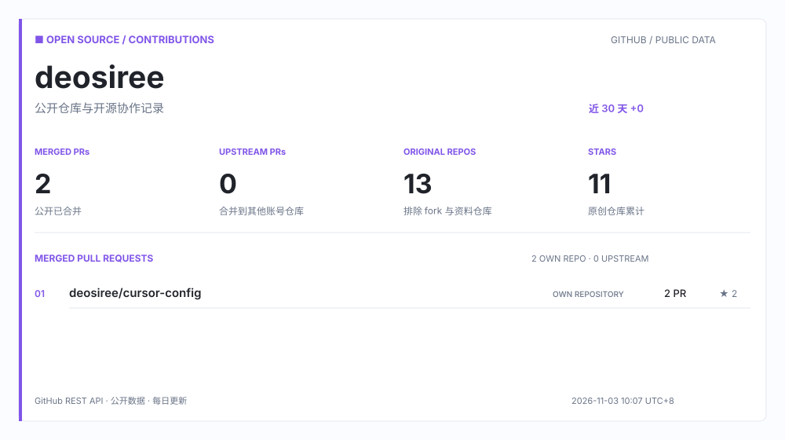

  <picture>
    <source media="(prefers-color-scheme: dark)" srcset="https://raw.githubusercontent.com/deosiree/deosiree/main/assets/open-source-dark.svg">
    <source media="(prefers-color-scheme: light)" srcset="https://raw.githubusercontent.com/deosiree/deosiree/main/assets/open-source-light.svg">
    
  </picture>

## 近期项目

| 项目 | 技术 | 仓库说明 |
| --- | --- | --- |
| [requirements-pool](https://github.com/deosiree/requirements-pool) | JavaScript | 需求缓冲池管理系统 |
| [translationtool](https://github.com/deosiree/translationtool) | Vue | 词条翻译工具 |
| [cursor-config](https://github.com/deosiree/cursor-config) | Vue | - |
| [deosiree.github.io](https://github.com/deosiree/deosiree.github.io) | HTML | 我的个人博客 |
| [my-rag-study](https://github.com/deosiree/my-rag-study) | Python | - |
| [my-ai-agents](https://github.com/deosiree/my-ai-agents) | Python | - |

  
统计口径

  统计仅使用公开 GitHub 数据。原创仓库数和 Stars 不包含 fork 或本资料仓库；合并 PR 按作者统计，并区分个人仓库与其他账号的仓库。数据卡片由 GitHub Actions 每日更新。

